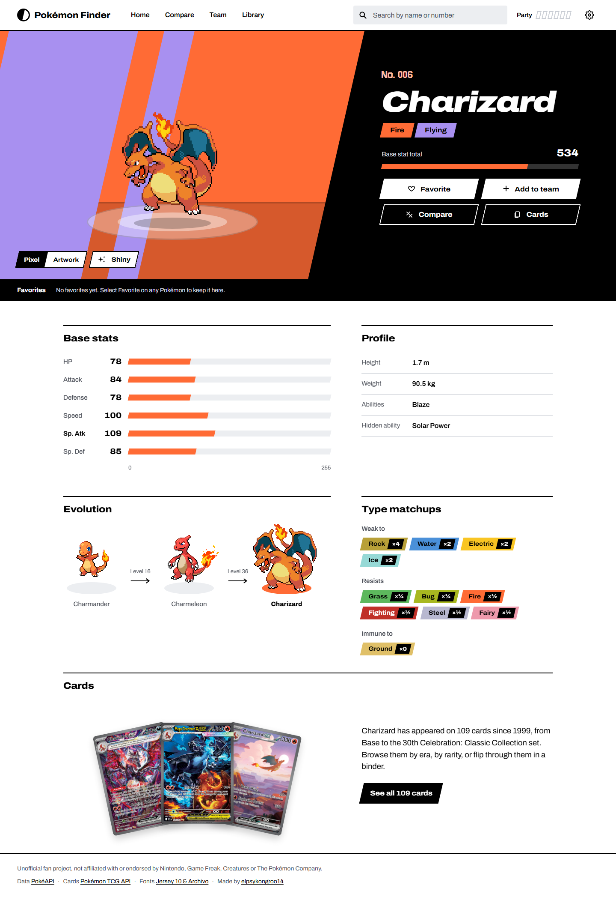

# Pokémon Finder

A Pokédex web app with a black-and-white interface where all the color comes from the
Pokémon on screen: look up any of the 1,025 Pokémon, compare two, build a party of
six, and browse their official trading cards.

**Live:** https://pokemon-finder-react-b8o.pages.dev

| Pokémon page                                                                                           | TCG Library                                                              |
| ------------------------------------------------------------------------------------------------------ | ------------------------------------------------------------------------ |
|  |  |

## Features

- **Search** by name or number, with live autocomplete and full keyboard support
- **Pokémon page:** animated encounter, stats, type matchups, evolution chains with
  their conditions, shiny toggle, favorites
- **Compare:** two Pokémon on a split versus screen with a stat-by-stat duel
- **Team:** a party of six, saved in your browser
- **TCG Library:** grid, table and binder views of a Pokémon's cards, holo tilt by
  rarity, and a card viewer
- Deep links for every page and view, settings for motion and sprite style, and a
  real accessibility pass (keyboard, screen reader, reduced motion, contrast)

## How it's built

| Area  | Choice                                                                                                                          |
| ----- | ------------------------------------------------------------------------------------------------------------------------------- |
| UI    | React 19, React Router 7, TypeScript, plain CSS with design tokens and cascade layers                                           |
| State | React Context + `useReducer`, persisted to `localStorage` through a tolerant loader                                             |
| Logic | Framework-free modules in `src/lib/`, each with unit tests                                                                      |
| Tests | Vitest + React Testing Library (1,300+ tests), Playwright end-to-end smoke tests, automated axe checks                          |
| Build | Vite, with bundle-size budgets checked in CI                                                                                    |
| CI/CD | GitHub Actions: lint, test, **build once**, end-to-end tests against that build, then deploy the same files to Cloudflare Pages |
| Data  | [PokéAPI](https://pokeapi.co/); [Pokémon TCG API](https://pokemontcg.io/) through a proxy                                       |

The card API needs a secret key, so the browser never calls it directly. It goes
through a small Cloudflare Worker that hides the key, allows only this app's origins,
rate-limits and caches:
[pokemon-finder-tcg-proxy](https://github.com/elpsykongroo14/pokemon-finder-tcg-proxy).

```
src/
  lib/         pure logic: no React, no DOM, fully unit-tested
  ui/          design-system primitives (Button, Tabs, Dialog, StatMeter...)
  components/  feature components built from the primitives
  pages/       one component per route
  hooks/       reusable stateful behavior
  context/     favorites, team and settings providers
  styles/      tokens, layers, type themes, motion
```

The layers only depend downward: `lib/` knows nothing about React, and primitives
know nothing about Pokémon.

## Running it locally

```bash
git clone https://github.com/elpsykongroo14/pokemon-finder-react.git
cd pokemon-finder-react
npm ci
cp .env.example .env
npm run dev          # http://localhost:5173
```

The default `.env` points at the deployed proxy, which allows `localhost:5173`, so the
card library works out of the box.

| Command            | What it does                              |
| ------------------ | ----------------------------------------- |
| `npm run dev`      | Development server                        |
| `npm test`         | Unit and component tests                  |
| `npm run test:e2e` | Production build + Playwright smoke tests |
| `npm run lint`     | ESLint and Stylelint                      |
| `npm run build`    | Typecheck and production build            |

## Documentation

- [Release process](docs/RELEASE.md)
- [Accessibility checklist](docs/A11Y-CHECKLIST.md)
- [Motion inventory](docs/MOTION-INVENTORY.md)
- [UI rehaul roadmap and decision log](docs/UI-REHAUL-ROADMAP.md)
- [Development log](DEVLOG.md): the whole project, entry by entry

## History

This is the second version of the app. The first was written without a framework,
in JavaScript and then TypeScript, and is archived at
[pokemon-finder](https://github.com/elpsykongroo14/pokemon-finder). This version
started as a phase-by-phase React rebuild of it and was then redesigned twice.

## Credits

Pokémon data from [PokéAPI](https://pokeapi.co/). Card data and images from the
[Pokémon TCG API](https://pokemontcg.io/). Pokémon and Pokémon character names are
trademarks of Nintendo, Creatures Inc. and GAME FREAK inc. This is an unofficial fan
project, not affiliated with or endorsed by them.
